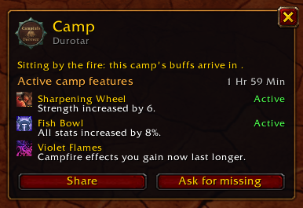
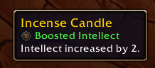
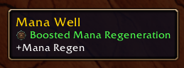
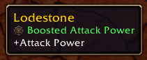
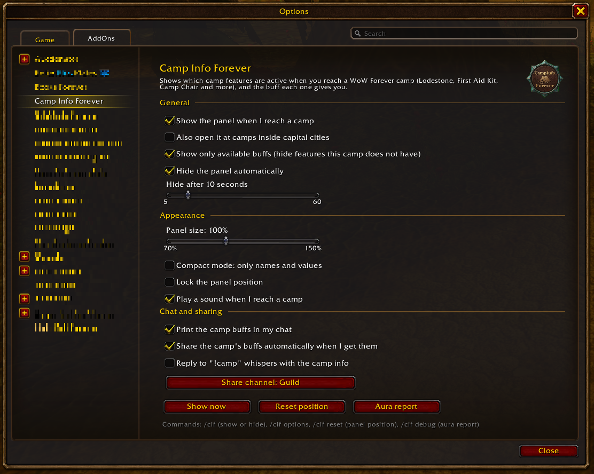

# CurseForge texts

## Summary

See which features your WoW Forever camp has and the buff each one gives you, the moment you arrive.

## Description

# Camp Info Forever

**Know your camp at a glance.** When you walk up to a campfire in WoW Forever, Camp Info Forever opens a small panel. Sit by the fire for a minute and it lists which camp features are active, the exact buff each one gives you, and what the camp is still missing.

No more hovering over the Camp Benefits buff and reading long tooltips.

---

## Features

- **Automatic camp detection.** The panel opens when you reach a campfire, counts down the minute you sit by it, and shows the camp's buffs when they arrive. It closes when you leave.
- **Buffs in object tooltips.** Point your mouse at a camp object such as a Mana Well, a Fish Bowl or a Camp Tent, and its tooltip shows the buff it gives when you sit by the fire, with the real value from the game.

    

- **See a camp before you sit.** Every camp object you point at near the fire is listed in the panel under *At this camp* until the camp's buffs arrive.
- **Real numbers for your level.** Values come straight from the game's own Camp Benefits aura, for example *Lodestone: Melee Attack Power +20*.
- **What's missing.** Features this camp doesn't have yet are listed in grey. You can turn this off with *Show only available buffs*.
- **Outdoor camps only.** The panel doesn't open by itself in capital cities, dungeons or raids. You can allow capital cities in the settings.
- **Share in chat.** One click posts the camp's buffs, or asks your group who can build the missing features.
- **`!camp` replies (optional).** Anyone who whispers you `!camp` gets the camp info back.
- **Automatic share (optional).** When the camp's buffs arrive, posts them in your share channel, for example *[Camp Info] Durotar: Lodestone (Melee Attack Power +12) / Mana Well (Mana every 5 sec +8)*. At most once every 5 minutes per place.
- **Compact mode, panel scaling, position lock and arrival sound.**
- **11 languages.**

## Supported camp features

| Feature | Buff |
|---|---|
| Lodestone | Melee Attack Power |
| First Aid Kit | Stamina |
| Sharpening Wheel | Strength |
| Incense Candle | Intellect |
| Faction Banner | Spirit |
| Camp Chair | Critical strike chance |
| Fish Bowl | All stats (%) |
| Enchanted Lute | Armor, all attributes and all resistances |
| Mana Well | Mana every 5 seconds |
| Camp Tent | Rested experience up to 5% of a level |
| Tanning Rack | Same as Camp Tent, and makes leatherworking reagents |
| Loom | Same as Faction Banner, and is used for tailoring recipes |
| Iron Oven | No buff, needed for advanced cooking recipes |
| Violet Flames | Campfire effects last longer |

The addon also lists features it doesn't know yet, as long as the game shows them in the Camp Benefits tooltip.

## Commands

| Command | What it does |
|---|---|
| `/cif` | Show or hide the panel |
| `/cif options` | Open the settings |
| `/cif reset` | Reset the panel position |
| `/cif debug` | Print the camp buff data to chat (useful for bug reports) |

`/campinfo` works too. You can also open the panel from the Addon Compartment menu next to the minimap.

## Settings

Find them under *Options › AddOns › Camp Info Forever*:

- **General:** open on arrival, also in capital cities, show only available buffs, auto-hide and its delay (5–60 seconds).
- **Appearance:** panel size (70%–150%), compact mode, lock position, sound on arrival.
- **Chat and sharing:** print to your own chat, automatic share, `!camp` replies, share channel (automatic, party, raid, guild or say).

## Languages

The addon's text is translated into these languages:

- English
- Türkçe
- Deutsch
- Français
- Español
- Português (BR)
- Русский
- Italiano
- 한국어
- 简体中文
- 繁體中文

Feature and buff names come from the game itself, in your client's language.

## Feedback

Found a camp feature that isn't listed, or a translation that could be better? Open an issue on [GitHub](https://github.com/simsekahmett/campinfo-forever). If you can, include the output of `/cif debug` taken while you stand in the camp.
