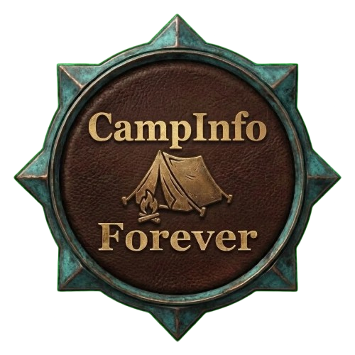
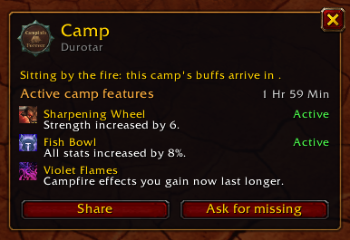
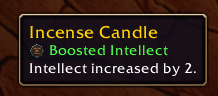
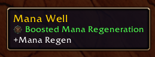
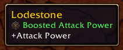
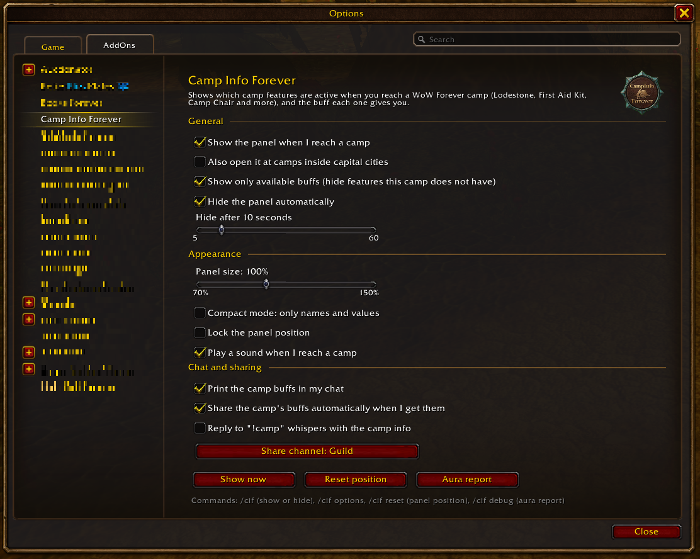

# Camp Info Forever

A World of Warcraft Forever addon (Interface 16001). When you reach a player-built camp, it shows which camp features are active and the buff each one gives you.

Point at a camp object to see the buff it gives:

  
  
  

## Camp features it knows

| Feature | Buff | Buff spell ID |
|---|---|---|
| Lodestone | Melee Attack Power | 1230164 |
| First Aid Kit | Stamina | 1230124 |
| Sharpening Wheel | Strength | 1230172 |
| Incense Candle | Intellect | 1229513 |
| Faction Banner | Spirit | 1229718 |
| Camp Chair | Critical strike chance (%) | 1229519 |
| Fish Bowl | All stats (%) | 1230098 |
| Enchanted Lute | Armor, all attributes, all resistances | 1230653 |
| Mana Well | Mana every 5 sec | 1230587 |
| Campfire (Campfire Nearby buff) | Opens the panel | 1283391 |
| Violet Flames (campfire) | Campfire effects last longer | 1328362 and others |

Higher tier objects give the same buff as the basic one they replace:

| Basic object | Higher tiers |
|---|---|
| Mana Well | Fermenter, Alchemy Laboratory |
| Sharpening Wheel | Anvil, Master Forge |
| Enchanted Lute | Arcane Salvager, Arcane Forge |
| Incense Candle | Greenhouse, Seed Hybridizer |
| Camp Tent (Rested experience up to 5% of a level) | Tanning Rack, Sewing Machine |
| Lodestone | Rock Garden, Molten Foundry |
| Camp Chair | Field Guide, Trapper's Workbench |
| Faction Banner | Spinning Wheel, Loom |
| First Aid Kit | Toxin Study, Plague Doctor's Laboratory |
| Fish Bowl | Fishing Rack, Fishing Hut |

Reagent Bot, Repair Bot, Anarchist's Workbench, Cookie's Feast and Iron Oven give no camp buff; their tooltips say what they are for.

The IDs come from the game's own data: the **Camp Benefits** aura (1229741) lists these features in its tooltip.
Tooltip texts come from the spell that builds each object (1307xxx), whose description gives the real value, for example "20 increased melee Attack Power" for a Lodestone.

## How it works
- At a camp you get the Camp Benefits aura. The addon reads its tooltip, so the panel shows the real numbers for your level, such as "Lodestone: Melee Attack Power increased by 20".
- It also checks each feature's buff by spell ID, in case the tooltip cannot be read.
- The panel opens on its own when you get the Campfire Nearby buff or reach a camp, or when a new feature starts giving you a buff. It closes when you leave.
- When you reach a campfire, the panel opens and asks you to sit by the fire for 1 minute. Until then the buffs on you are from your last camp, so the panel does not list them, and Share waits too.
- While you sit, the panel counts down the minute until the camp's buffs arrive. Then it lists this camp's features.
- Point your mouse at a camp object (Mana Well, Fish Bowl, Camp Tent, Loom, ...) and its tooltip shows the buff it gives when you sit by the fire. The game does not tell addons which objects stand around a fire, so this is the way to see them before you sit. Each object you point at near the fire is also listed in the panel under "At this camp" until this camp's buffs arrive.
- It also lists, greyed out, the features this camp does not have, unless "Show only available buffs" is on.
- If the tooltip shows a feature the addon does not know yet, it is still listed.

## Camps shared between players
Camps you visit are shared with other players who use the addon, over a hidden chat channel (`CampInfoForever`): the camp's position, layer and objects. Before you sit, the panel lists what others saw at this fire with "Last seen: HH:MM". Away from camps, it lists up to five camps seen on your map. Nothing older than 15 minutes is shown, because fires and camp objects last 15 minutes. Other players can see that the messages come from your character. Turn it off with "Share camps I visit with other players of the addon".

## Camps on the map
Camps seen in the last 15 minutes are campfires on the world map, fading as they get older. Point at one for its objects, their buffs and when they were last seen. Opening a zone's map asks other players of the addon about its camps. On by default.

## Sharing in chat
- **Share** button on the panel: posts the camp's active features to your chosen channel, for example `[Camp Info] Ruins of Lordaeron: Faction Banner (Spirit +14); Camp Chair (Crit Chance +2%) - 53 Min left`.
- **Ask for missing** button: posts the features this camp lacks and asks if anyone can build them.
- Share channel: automatic (raid > party > say), party, raid, guild or /say. The buttons can use /say because they are clicked.
- Optional: share the camp's buffs automatically when you get them, in the share channel you chose, for example `[Camp Info] Durotar: Lodestone (Melee Attack Power +12) / Mana Well (Mana every 5 sec +8)`. At most once every 5 minutes per place. The game only allows /say from a click, so with /say chosen the addon uses your group instead.
- Optional: answer a whispered `!camp` with the camp info.

## Settings

General: open on arrival, also in capital cities, show only available buffs, auto-hide and its delay (5 to 60 seconds).
Appearance: panel size (70% to 150%), compact mode, lock position, sound on arrival.
Chat and sharing: print to your own chat, automatic share, `!camp` replies, sharing camps with other players of the addon, camps on the map, share channel.

The panel opens on its own only at camps out in the world: not in capital cities (unless you turn that on), dungeons or raids.

## Commands
- `/cif` show or hide the panel
- `/cif options` open the settings
- `/cif reset` reset the panel position
- `/cif debug` print your buffs and the Camp Benefits text to chat, to help add new features

## Languages
English, Türkçe, Deutsch, Français, Español, Português (BR), Русский, Italiano, 한국어, 简体中文, 繁體中文. Feature and buff names come from the game, in your client's language.

## Install
Install it from [CurseForge](https://www.curseforge.com/), or copy this folder to `World of Warcraft\_forever_\Interface\AddOns\CampInfoForever`.

## Releasing
Releases are built by [BigWigsMods/packager](https://github.com/BigWigsMods/packager) in GitHub Actions (`.github/workflows/release.yml`).

1. One time: create an API token at https://legacy.curseforge.com/account/api-tokens and add it to the GitHub repository as the secret `CF_API_TOKEN`.
2. Push a tag: `git tag v1.4.0` then `git push origin v1.4.0`.

The workflow puts the tag into `## Version`, builds the zip without the files listed in `.pkgmeta`, and uploads it to CurseForge project 1824945 and to GitHub Releases. A tag containing `alpha` or `beta` is uploaded as an alpha or beta file.
